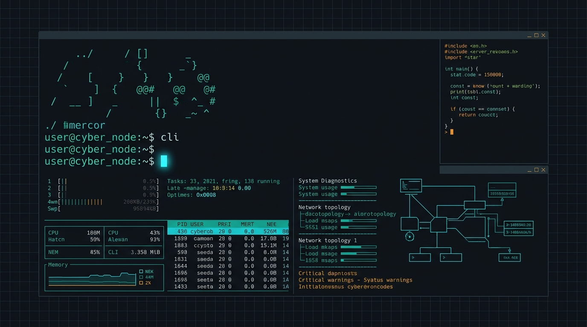

<div align="center">



<br/><br/>

# Hey, I'm <span style="color: #22D3EE;">Sudeep Kushwaha</span> 👋

`bakaprince@github:~$ whoami`

**B.Tech Computer Science (AI & ML) • Second Year @ VIT Bhopal University**  
*A student engineer learning by building useful software — focusing on applied machine learning, practical Android apps, and robust systems.*

<br/>

<a href="https://github.com/bakaprince?tab=repositories">
  
</a>
<a href="https://github.com/bakaprince/leetcode-grind">
  
</a>
<a href="mailto:bakaprince@users.noreply.github.com">
  
</a>

</div>


## ⚡ About Me & Engineering Focus

> *"Learn consistently. Build things that work. Improve what you ship."*

I am an undergraduate student who approaches software engineering from first principles — writing functional code, testing real datasets, and developing practical software for everyday utility.

<table width="100%">
<tr>
<td width="50%" valign="top">

### 🎯 Primary Technical Pursuits
* 🚀 **Applied Machine Learning:** Developing predictive models with Scikit-learn, inspecting feature attribution via SHAP, and simulating residual risk.
* 📱 **Android Development:** Building native mobile utilities with Kotlin and Android Studio with an offline-first mindset.
* 🧱 **Core Foundations:** Practicing Object-Oriented Programming, clean application structure, and relational database design.

</td>
<td width="50%" valign="top">

### 📍 Academic & Practice Snapshot
* 🎓 **Education:** B.Tech in Computer Science & Engineering (Specialization in AI & ML), 2nd Year, VIT Bhopal University.
* 🧩 **DSA Rigor:** Continuous problem solving on LeetCode covering dynamic programming, graph algorithms, and data structures in Java & C++.
* 🛠️ **Workflow:** Git version control, modular code organization, and documented workflows.

</td>
</tr>
</table>


## 🧰 Languages & Technologies

<div align="center">

### Core Programming Languages
<a href="https://github.com/bakaprince">
  
</a>

<br/>

### Machine Learning & Data Science
<p align="center">
  
  
  
  
  
  
</p>

### Android & Application Development
<a href="https://github.com/bakaprince">
  
</a>

<br/>

### Databases & Cloud Backend
<a href="https://github.com/bakaprince">
  
</a>

<br/>

### Developer Workflow & Tools
<a href="https://github.com/bakaprince">
  
</a>

</div>


## 💎 Core Competencies

<table width="100%">
<tr>
<td width="33%" valign="top">

#### 01 / Predictive Modeling
* Supervised learning pipelines
* Feature preprocessing & normalization
* Model evaluation ($R^2$, MAE, RMSE)
* Feature attribution with SHAP
* Monte Carlo risk simulation

</td>
<td width="33%" valign="top">

#### 02 / Mobile Engineering
* Native Android applications (Kotlin/Java)
* Clean component separation
* Activity lifecycles & local storage
* REST API & cloud integration
* Lightweight, responsive UI

</td>
<td width="33%" valign="top">

#### 03 / Data & Algorithms
* Relational database design (MySQL)
* Schema normalization & queries
* Algorithmic pattern practice (LeetCode)
* Space and time complexity optimization
* Object-Oriented principles

</td>
</tr>
</table>


## 🚀 Featured Engineering Projects

### 01 — VITBIT • Android Academic Companion
> **Targeted Android application engineered to organize student schedules, attendance metrics, and campus academic utilities into an offline-first experience.**

```
Status: Stable Release Available     Platform: Android (Kotlin / Java)     Architecture: Native Mobile
```

* **The Problem:** University academic portals are often cumbersome to navigate on mobile devices, making daily lecture schedules and attendance tracking stressful for students between classes.
* **Implemented Features:**
  * Fast timetable view structured around campus slot patterns.
  * Attendance monitoring with percentage calculations to stay above required thresholds.
  * Lightweight, offline-capable architecture designed for instant launch and low memory overhead.
* **Verified Technologies:** `Kotlin` `Android Studio` `Java` `Android SDK`
* **Links:**
  * 📦 [**vitbit-stable Repository**](https://github.com/bakaprince/vitbit-stable)
  * 🔖 [**Releases & Builds**](https://github.com/bakaprince/vitbit-stable/releases)

---

### 02 — CashFlowAI • Financial Analytics & Decision Engine
> **Intelligent cash flow forecasting and risk decision platform combining supervised regression, explainable AI, what-if perturbation, and Monte Carlo probability modeling.**

```
Status: Implemented & Verified       Stack: Python / Scikit-learn / Streamlit     Domain: Financial ML & XAI
```

* **The Problem:** Financial teams frequently rely on static historical spreadsheets without the ability to simulate downside risk distributions or identify which operational levers drive liquidity shortfalls.
* **Implemented Features:**
  * **Automated Data Pipeline:** Ingestion of raw transactional records with regex cleaning, currency stripping, and median missing-value imputation.
  * **ML Cash Flow Forecasting:** Multiple linear regression with comprehensive statistical evaluation (MAE, RMSE, $R^2$).
  * **Explainable AI (SHAP):** Feature attribution isolating directional factors behind liquidity projections.
  * **Scenario Simulation & Monte Carlo:** 2,000-iteration residual perturbation determining the exact empirical probability of breaching user safety buffers (P10 downside vs P90 upside).
* **Verified Technologies:** `Python` `Scikit-learn` `SHAP` `Plotly` `Streamlit` `NumPy` `Pandas`
* **Links:**
  * 💻 [**CashFlowAI Repository**](https://github.com/bakaprince/CashFlowAI)

---

### 03 — SwasthyaSetu • Digital Healthcare Platform
> **Full-stack digital healthcare system designed to streamline patient-provider interaction, medical records, and digital consultation workflows.**

```
Status: Deployed & Live              Stack: Web Full-Stack / Cloud Architecture   Domain: Digital Health
```

* **The Problem:** Healthcare management across clinics remains fragmented, with disjointed appointments, inaccessible diagnostic histories, and inefficient patient triage.
* **Implemented Features:**
  * Role-based interfaces connecting patients and healthcare providers.
  * Appointment scheduling, record management, and consolidated care workflows.
  * Cloud-deployed architecture providing responsive access across mobile and desktop browsers.
* **Verified Technologies:** `JavaScript` `React / Web Frontend` `Cloud Backend` `Vercel`
* **Links:**
  * 🌐 [**Live Application Demo**](https://swasthya-setu-drcode.vercel.app/)
  * 💻 [**SwasthyaSetu Repository**](https://github.com/bakaprince/SwasthyaSetu)

---

### 04 — AgriSure • Transparent Agricultural Ecosystem
> **Farmer-centric digital platform built to improve agricultural transparency, crop advisory, and marketplace access.**

```
Status: Live Prototype               Deployment: Netlify                          Domain: AgriTech Solutions
```

* **The Problem:** Information gaps in farming lead to sub-optimal crop selection, lack of direct pricing transparency, and delayed access to modern advisories.
* **Implemented Features:**
  * Clean, accessible UI tailored for agricultural decision support.
  * Dedicated crop advisory tools and market insights.
  * Transparent information routing designed to support farmer decision-making.
* **Verified Technologies:** `Web Technologies` `HTML / CSS / JS` `Netlify Hosting`
* **Links:**
  * 🌐 [**Live Demo Deployment**](https://agrisure-f3.netlify.app/)
  * 💻 [**AgriSure Repository**](https://github.com/bakaprince/AgriSure)


## 🔬 Machine Learning & DSA Projects

<table width="100%">
<tr>
<td width="50%" valign="top">

#### 📱 Smartphone Addiction Predictor
Predictive behavioral model analyzing user habits, screen duration, and usage frequency to detect addiction indicators.
* **Stack:** `Python` `Scikit-learn` `Pandas`
* **Focus:** Data exploration, classification metrics & baseline accuracy.
* 🔗 [**View Repository**](https://github.com/bakaprince/smartphone-addiction-predictor)

<br/>

#### 📨 Spam Message Classifier
Natural language processing prototype classifying incoming text and SMS messages with text vectorization and probabilistic inference.
* **Stack:** `Python` `NLP` `Scikit-learn`
* **Focus:** Tokenization, feature extraction & binary text classification.
* 🔗 [**View Repository**](https://github.com/bakaprince/spam-message-classifier)

</td>
<td width="50%" valign="top">

#### 📈 Student Performance Predictor
Regression-driven academic model examining socioeconomic and behavioral indicators to predict scholastic outcomes.
* **Stack:** `Python` `EDA` `Linear Regression`
* **Focus:** Feature correlation, normalization & evaluation curves.
* 🔗 [**View Repository**](https://github.com/bakaprince/student-performance-predictor)

<br/>

#### 🧩 LeetCode Grind • Data Structures & Algorithms
Structured, continuous algorithm practice implementing optimal solutions in Java and C++.
* **Key Topics:** Arrays, Hash Tables, Two Pointers, Trees, Dynamic Programming.
* **Focus:** Space/time complexity optimization and clean problem-solving.
* 🔗 [**View Repository**](https://github.com/bakaprince/leetcode-grind)

</td>
</tr>
</table>


## 📊 Activity & Statistics

<div align="center">

<table border="0">
<tr>
<td align="center">
  
</td>
<td align="center">
  
</td>
</tr>
</table>

<br/>


<br/><br/>


</div>


## 🛰️ Currently Exploring

* **Applied Machine Learning:** Advancing from local models to production deployment, inference pipelines, and model evaluation.
* **Algorithms & Problem Solving:** Deepening knowledge of graph traversal, dynamic programming, and competitive problem solving in Java / C++.
* **Android Architecture:** Exploring Jetpack Compose and modern reactive patterns for mobile systems.
* **Databases:** Relational schema design, query optimization, and transaction handling with MySQL.


## 🌐 Connect With Me

<div align="center">

<p>
  Feel free to explore my repositories, test live demonstrations, or connect to discuss engineering projects!
</p>

<p align="center">
  <a href="https://github.com/bakaprince">
    
  </a>
  <a href="mailto:bakaprince@users.noreply.github.com">
    
  </a>
  <a href="https://github.com/bakaprince?tab=repositories">
    
  </a>
</p>

<br/>

<sub>Crafted with engineering precision • Sudeep Kushwaha (@bakaprince)</sub>

</div>
