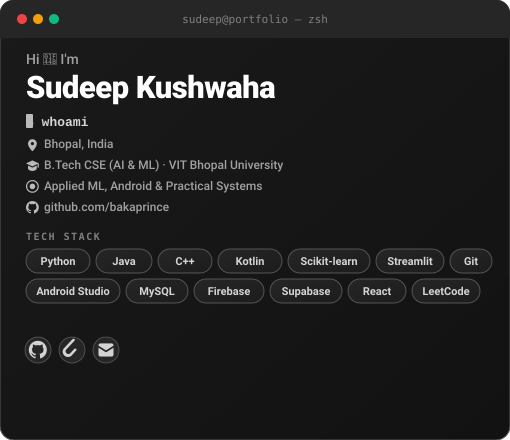

  
  &nbsp;&nbsp;
  

 

  
  &nbsp;
  
  &nbsp;
  
  &nbsp;
  

  <b>Computer Science Undergraduate · B.Tech CSE (AI &amp; ML) @ VIT Bhopal University</b> 
  Applied Machine Learning · Native Android Development · Relational Data Engineering · Algorithmic Foundations

### 📦 Featured Engineering Systems & Highlights

  
  &nbsp;&nbsp;
  

| System | Focus Area | Verified Stack | Access Link |
| :--- | :--- | :---: | :---: |
| [**`VITBIT`**](https://github.com/bakaprince/vitbit-stable) | Offline-First Academic & Attendance Companion for Android | `Kotlin` `Android Studio` `Java` | [**📦 Stable Releases**](https://github.com/bakaprince/vitbit-stable/releases) |
| [**`CashFlowAI`**](https://github.com/bakaprince/CashFlowAI) | ML Forecasting, SHAP Explainability & Monte Carlo Risk Simulation | `Python` `Scikit-learn` `SHAP` | [**💻 Source Code**](https://github.com/bakaprince/CashFlowAI) |
| [**`SwasthyaSetu`**](https://github.com/bakaprince/SwasthyaSetu) | Full-Stack Healthcare Platform for Patient-Doctor Interaction | `React` `JavaScript` `Cloud Backend` | [**🌐 Live Demo**](https://swasthya-setu-drcode.vercel.app/) |
| [**`AgriSure`**](https://github.com/bakaprince/AgriSure) | Agricultural Transparency, Advisory & Farmer Decision Engine | `HTML` `CSS` `JavaScript` | [**🌐 Live Demo**](https://agrisure-f3.netlify.app/) |

---

### ⚡ Overview

I'm a Computer Science undergraduate (B.Tech CSE with specialization in AI &amp; ML at VIT Bhopal University) who learns by engineering practical, working software: from predictive machine learning workflows and database-backed platforms to native Android apps and algorithmic problem solving.

- **Applied Machine Learning & XAI:** Designing end-to-end data preprocessing pipelines, supervised regression models with **Scikit-learn**, model interpretability via **SHAP (SHapley Additive exPlanations)**, and empirical risk distribution modeling using **Monte Carlo simulations**.
- **Mobile & Full-Stack Systems:** Building native Android applications with **Kotlin**, **Java**, and **Android Studio** prioritizing offline-first reliability and low memory footprint; developing full-stack web platforms backed by **MySQL**, **Firebase**, and **Supabase**.
- **Algorithmic Problem Solving:** Actively practicing Data Structures &amp; Algorithms in **Java** and **C++** on LeetCode with rigorous emphasis on asymptotic space/time complexity optimization.

> **Current Focus:** Advancing machine learning model evaluation and inference serving, deepening algorithmic fluency across dynamic programming and graphs, and building high-utility Android and web applications.

---

## 🛠️ Languages & Technologies

  <b>Languages & Core:</b> 
  
  
  
  
  
  
  
  

  <b>AI / Machine Learning / Data Science:</b> 
  
  
  
  
  
  
  

  <b>Android & Application Development:</b> 
  
  
  

  <b>Databases & Cloud Infrastructure:</b> 
  
  
  

  <b>Developer Workflow & Tools:</b> 
  
  
  
  

---

### 🧩 Core Competencies

<table width="100%">
  <tr>
    <td width="50%" valign="top">
      <h4>⚡ Predictive Modeling & Applied AI</h4>
      <ul>
        <li><b>Supervised Learning Pipelines:</b> Regression and classification models with Scikit-learn, cross-validation, and out-of-sample statistical metrics ($R^2$, MAE, RMSE)</li>
        <li><b>Explainability (XAI):</b> Decomposing predictive outcomes with SHAP to isolate positive and negative feature attribution</li>
        <li><b>Probabilistic Risk Simulation:</b> Monte Carlo perturbation modeling with percentile distributions (P10 downside vs P90 upside)</li>
        <li><b>Data Preprocessing:</b> Robust regex normalization, missing-value median imputation, and automated data cleaning pipelines</li>
      </ul>
    </td>
    <td width="50%" valign="top">
      <h4>📱 Android & Application Engineering</h4>
      <ul>
        <li><b>Native Android Systems:</b> Android SDK, Kotlin, Java, and Android Studio for offline-first mobile utilities</li>
        <li><b>State & Lifecycle Management:</b> Activity lifecycle control, persistent local storage, and responsive UI layouts</li>
        <li><b>Full-Stack Integration:</b> RESTful client-server communication, JSON schema parsing, and authenticated cloud synchronizations</li>
        <li><b>Front-End Interfaces:</b> Responsive web interfaces using React, JavaScript, HTML5, and CSS3</li>
      </ul>
    </td>
  </tr>
  <tr>
    <td width="50%" valign="top">
      <h4>🗄️ Relational Data & Backend Architecture</h4>
      <ul>
        <li><b>Relational Schema Design:</b> MySQL entity modeling, normalization, indexed queries, and relational integrity</li>
        <li><b>BaaS Integration:</b> Supabase and Firebase for structured real-time databases and lightweight authentication</li>
        <li><b>System Architecture:</b> Decoupled modular design separating data ingestion, business logic, and UI display</li>
        <li><b>Tooling & Scripting:</b> Python and Bash automation scripts for local workflow enhancements</li>
      </ul>
    </td>
    <td width="50%" valign="top">
      <h4>🧩 Algorithmic Foundations & Practice</h4>
      <ul>
        <li><b>Core Data Structures:</b> In-depth implementation of Arrays, Linked Lists, Hash Tables, Stacks, Queues, Heaps, and Trees</li>
        <li><b>Algorithm Paradigms:</b> Dynamic Programming, Two Pointers, Sliding Window, DFS/BFS traversals, and Binary Search</li>
        <li><b>Complexity Analysis:</b> Rigorous evaluation of asymptotic time ($\mathcal{O}$) and space trade-offs</li>
        <li><b>Object-Oriented Design:</b> Clean OOP principles, abstraction, modularity, and readable implementation in Java &amp; C++</li>
      </ul>
    </td>
  </tr>
</table>

---

### 🚀 Featured Engineering Systems

#### **1. VITBIT — Native Android Academic Companion & Timetable System**
> Offline-first Android application engineered to solve daily academic coordination problems for university students. Features rapid timetable tracking structured around campus slot patterns, intelligent attendance monitoring with safe-margin calculations to maintain institutional thresholds, low-latency navigation, and an optimized, lightweight APK footprint designed for instant startup without network reliance.

  
  
  
  
  
  

[→ Stable Releases](https://github.com/bakaprince/vitbit-stable/releases) &nbsp;|&nbsp; [→ Source Code](https://github.com/bakaprince/vitbit-stable)

---

#### **2. CashFlowAI — Machine Learning Cash Flow Forecasting & Risk Simulation Engine**
> Intelligent financial analytics platform combining supervised machine learning forecasting, explainable AI (XAI), what-if scenario simulations, Monte Carlo probabilistic risk modeling, and strategic decision support. Features raw transactional data ingestion with automated imputation, out-of-sample regression evaluation ($R^2$, MAE, RMSE), SHAP feature attribution isolating operational liquidity drivers, and 2,000-iteration residual perturbation quantifying downside breach risks (P10) versus upside potential (P90).

  
  
  
  
  
  
  

[→ Source Code](https://github.com/bakaprince/CashFlowAI) &nbsp;|&nbsp; [→ Architecture Document](https://github.com/bakaprince/CashFlowAI/blob/main/SYSTEM_ARCHITECTURE.md)

---

#### **3. SwasthyaSetu — Full-Stack Digital Healthcare Coordination Platform**
> Comprehensive full-stack digital health platform engineered to bridge patients and healthcare professionals through consolidated consultation workflows, diagnostic record management, and appointment scheduling. Features responsive role-based interfaces, cloud backend integrations, and production deployment tuned for cross-device web usability.

  
  
  
  

[→ Live Production Demo](https://swasthya-setu-drcode.vercel.app/) &nbsp;|&nbsp; [→ Source Code](https://github.com/bakaprince/SwasthyaSetu)

---

#### **4. AgriSure — Transparent Agricultural Information & Farmer Advisory Engine**
> Farmer-centric digital platform built to improve agricultural transparency, crop advisory workflows, and regional market access. Designed with accessibility-first UI patterns to eliminate information bottlenecks, support agricultural yield optimization, and provide transparent decision support.

  
  
  

[→ Live Production Demo](https://agrisure-f3.netlify.app/) &nbsp;|&nbsp; [→ Source Code](https://github.com/bakaprince/AgriSure)

---

### 🔬 Additional Engineering & Algorithmic Projects

<table width="100%">
  <tr>
    <td width="50%" valign="top">
      <h4>📱 Smartphone Addiction Predictor</h4>
      
Supervised behavioral classification model analyzing screen duration, application frequency, and usage habits to predict user addiction tendencies.

      
<b>Stack:</b> <code>Python</code> <code>Scikit-learn</code> <code>Pandas</code>

      <a href="https://github.com/bakaprince/smartphone-addiction-predictor">→ View Repository</a>
    </td>
    <td width="50%" valign="top">
      <h4>📨 Spam Message Classifier</h4>
      
Natural language processing classifier filtering unwanted text and SMS messages utilizing tokenization, count vectorization, and probabilistic models.

      
<b>Stack:</b> <code>Python</code> <code>NLP</code> <code>Scikit-learn</code>

      <a href="https://github.com/bakaprince/spam-message-classifier">→ View Repository</a>
    </td>
  </tr>
  <tr>
    <td width="50%" valign="top">
      <h4>📈 Student Performance Predictor</h4>
      
Exploratory data analysis and regression modeling evaluating academic, socioeconomic, and lifestyle factors to predict academic outcomes.

      
<b>Stack:</b> <code>Python</code> <code>EDA</code> <code>Scikit-learn</code>

      <a href="https://github.com/bakaprince/student-performance-predictor">→ View Repository</a>
    </td>
    <td width="50%" valign="top">
      <h4>🧩 LeetCode Grind • Data Structures &amp; Algorithms</h4>
      
Systematic algorithm and data structures practice tracking optimal problem-solving implementations across dynamic programming, trees, graphs, and arrays in Java &amp; C++.

      
<b>Stack:</b> <code>Java</code> <code>C++</code> <code>Algorithms</code>

      <a href="https://github.com/bakaprince/leetcode-grind">→ View Repository</a>
    </td>
  </tr>
</table>

---

## 📊 GitHub Contribution & Activity

  

    
  

  

    
    &nbsp;
    
  

  
  

    
    &nbsp;
    
  

---

## 🔭 Currently Exploring & Engineering

- **Applied Machine Learning Pipelines:** Deploying trained regression and classification models with automated validation and inference monitoring.
- **Advanced Algorithmic Practice:** Mastering dynamic programming memoization, topological sorting, and graph traversals in C++ and Java.
- **Modern Mobile Architecture:** Deepening knowledge of Android app components, background workers, and reactive UI patterns with Kotlin.
- **Relational Query Optimization:** Designing scalable MySQL schemas, indexing strategies, and database normalization for high data integrity.

---

## 🤝 Connect With Me

  
  &nbsp;&nbsp;
  
  &nbsp;&nbsp;
  

---

  Engineered with precision by <b>Sudeep Kushwaha</b> · B.Tech CSE (AI &amp; ML) @ VIT Bhopal University

